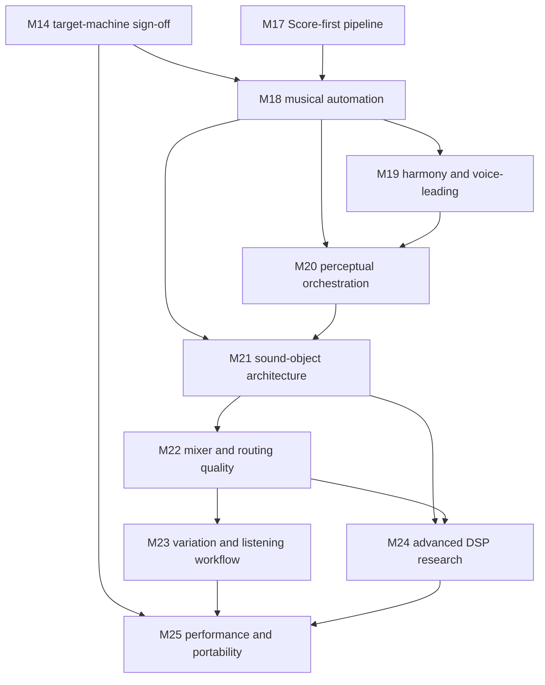

# Reawarp roadmap — consolidated status and next milestones

**Updated:** 2026-11-25  
**Current implementation baseline:** M21 and M22 are implemented and closed on `main`. M19 includes optional pitch fields, tuning-aware sonorities, sequence-level voice-leading, six independent bass-role grammars, motif identity contracts, and exact Reawarp pitch metadata in MIDI. M14 hardware profiling and matched-level/Pyo listening remain separate experimental sign-offs.
**Roadmap policy:** milestone documents describe implementation status and acceptance criteria. Proposed features must be labelled planned; they must not be presented as implemented.

## Product direction

Reawarp is an offline-first, deterministic IDM composition and sound-design laboratory. It is not intended to become a general-purpose DAW. Its distinctive value is the combination of mathematically derived rhythmic material, formal composition planning, independent stem regeneration, hybrid synthesis, break transformation, a personal sound library, and non-destructive offline mixing.

The canonical target workflow is:

`Configuration → Form/Role Plan → Score → Dry Stem Render → FX Routing/Automation → Export + Provenance`

M17.5 completed the canonical Score-first cutover for event-backed roles: `generate()` now plans a rational-beat Score before rendering, ScoreRenderer owns event scheduling, and the legacy project-event dictionaries are derived afterwards. Noise texture and ambience remain specialised whole-field passes represented by Score markers. M18 extends the shared control bus into deterministic score sources and scoped modulation, and now drives per-note ADSR and vibrato in the production melodic palettes; planner authoring, remaining synthesis/FX mappings, listening and target-machine validation remain.

## Implemented baseline

| Area | Status | Notes |
|---|---|---|
| Deterministic event generation | Implemented | Named independent random streams and per-stem regeneration |
| Formal section planning | Implemented | Multiple structure grammars, deterministic flow operations and section-level controls |
| Pattern relationships | Implemented | Interlock, shadow, call-response and counter-accent families |
| Percussion and break generation | Implemented | Procedural lanes, imported break slicing and transforms |
| Melodic synthesis | Implemented | Distinct subtractive and alternative synthesis paths |
| Ambience/texture stems | Implemented | Separate generated roles |
| Project stems and provenance | Implemented | Dry stems, events and generation metadata |
| Score and MIDI interchange | Implemented | M17.5 makes rational-beat Score authoritative for event-backed rendering; project events remain a compatibility projection; MIDI 1.0 limitations are documented |
| Local sample/stem library | Implemented | SQLite indexing, descriptors, search, collections and genealogy |
| FX Lab and editable serial chains | Implemented | Optional Pyo offline backend and portable JSON |
| Role-aware inserts and shared returns | Implemented | Fixed SPACE/ECHO buses; role-aware effects are the default; explicit dry mode remains for A/B |
| Beat-based FX automation | Implemented | Static-BPM lanes for insert wet, sends and return wet |
| GUI / CLI workflow | Implemented | Grouped Compose / Produce / Assets navigation, shared project context and transport, responsive splitters, and a project-aware Stem Mixer empty state; controller extraction remains planned |
| Regression testing | Implemented baseline; M18 CI passed | Latest M18 matrix: 129 tests passed on Linux Python 3.10, 3.11 and 3.12 and Windows Python 3.11; desktop and CLI/benchmark smoke checks passed |
| Target-machine DSP listening validation | Pending | Requires Pyo-enabled Windows render and critical audition |
| Performance benchmark baseline | Partially implemented | Reproducible benchmark harness and phase timings are present; target-Windows 30/180-second results are pending |

## Current focus — M14: Reliability and Performance Baseline

**Status:** Portable implementation and CI acceptance passed on `main` (commit `3ea19f7`). The milestone remains open for 48 kHz target-Windows 30/180-second profiling and Pyo-enabled critical listening.

**Goal:** Make changes to the generator safe, measurable and repeatable before expanding the composition and DSP surface.

### Delivered on `main`

- Expanded the pytest suite to 59 tests, including short/silent/stereo transform cases, seeded full-chain transforms, score JSON and MIDI round trips, exported-project reopen validation, and GUI navigation transitions.
- Added `GenerationConfig.from_dict`, PCM `read_wav` with preserved channel layout, and `ReawarpProject.load` with schema, configuration, timing, stem alignment, finiteness and score-metadata validation.
- Added a native Windows Python 3.11 CI job. Linux Python 3.10, 3.11 and 3.12 plus Windows Python 3.11 all pass the regression suite; CLI/benchmark/desktop smoke checks also pass.
- Retained the named-stream, exact-duration, dry-buffer immutability, FX routing and signal-diagnostic checks already in the suite.

### Remaining sign-off

1. Run the 30-second and 180-second benchmark cases at 48 kHz on the target Windows machine; record the processor, memory, Python, NumPy, SciPy versions, render time, real-time factor and peak memory.
2. Profile any measured hotspots and optimise only where the evidence supports it, preserving deterministic output and the current signal contracts.
3. Run the optional Pyo-enabled integration and critical listening checks on the target audio setup, including low-volume and mono compatibility.

### Explicitly out of scope

No new synthesis palette, arbitrary routing graph, convolution engine or GPU port in M14. The first navigation/layout redesign is included; a broader controller/service extraction remains a follow-on task.

## M15: Composition Director 2.0 — motifs, roles and transitions

**Status:** Implementation landed on `main`; 66 regression tests pass on Linux Python 3.10–3.12 and Windows Python 3.11. Subjective listening validation remains pending.

**Goal:** Make long-form arrangements feel composed rather than like a sequence of section-level parameter states.

### Delivered in this increment

- Stable motif identity extracted from a named source phrase; section instances share the identity and carry explicit transformation history.
- Deterministic repetition, displacement, fragmentation, augmentation/diminution, inversion, retrograde, rhythmic shadow, call/response, return and dissolve transformations.
- Motif-driven melody events on the shared sixteenth-note clock. The same phrase rhythm can create restrained hi-hat shadows and snare responses.
- Seven-role section orchestration plans for kick, snare, hats, break, melody, texture and ambience, each with activity, density, syncopation, register, brightness, space and motif relation.
- Bar-aligned transition windows derived from the phrase grammar. Transition envelopes implement pickups/fills, subtraction, rhythmic collapse, hard cuts/silence gates, reverse-swell/riser intentions, call/response reassembly and echo handoffs.
- Independent Generator controls for density, syncopation, instability, melodic activity, register, tonal brightness and spatial intent.
- Project metadata records the motif, every section instance, role plans, transition gestures and the axis values used.

### Acceptance criteria

- Fixed seeds reproduce motif identity, section transformations, cross-role accents and role/transition plans.
- Return sections recall the source motif; development/contrast sections change selected dimensions while retaining identity.
- Each section has a distinguishable orchestration purpose independent of a single energy scalar.
- Transition gestures remain inside their source phrase/bar window; all rendered buffers retain exact duration and aligned stems.
- Regenerating melody does not mutate the other role stems; named random streams remain isolated.
- Tests cover transformation rules, role-plan determinism, transition boundaries, cross-role motif use and full-engine integration.

### Listening protocol

Compare the same seed in a full render and in isolated kick/snare/hat/melody/texture/ambience stems. Listen for the anchor phrase in establishment and return sections, controlled transformation in development, a recognisable call/response in contrast, deliberate subtraction through drop/void sections, and enough negative space around transitions. Numeric tests establish timing and repeatability, not subjective musical quality.

## M16: Score-driven render core

**Status:** Foundation implemented; completed by the M17.5 canonical Score-first generation cutover. A score-native offline renderer, shared beat/frame timeline, typed automation control bus, production voices, sample triggers, break slicing, FX compatibility and Score provenance are now in the active generation path.

**Goal:** Make the universal score the canonical symbolic event representation consumed by the audio renderer.

### Delivered in this increment

- RenderTimeline maps rational beats to seconds and sample frames through step and linear tempo maps, and maps frames back to musical time.
- Meter-map bar/beat queries are available on the render timeline; meter changes remain independent from tempo and pattern cycles.
- ScoreRenderer consumes Score.events, schedules note/hit/grain/trigger events onto sample frames, and renders aligned dry per-voice stereo stems.
- Production/custom voice callbacks receive a ScheduledScoreEvent and shared AutomationControlBus; the score core owns frame placement, velocity, mono panning and finite-buffer validation.
- AutomationTargetRegistry defines synthesis, FX and MIDI control domains, units, value types, ranges and interpolation. Beat-, second- and frame-based lanes are evaluated against the same absolute frame clock.
- Project-derived scores retain score-renderer version, source generator version, root seed, sample rate, frame count, duration, named seed streams and generator-family provenance.
- Existing project and score schema version 1 remain readable; MIDI 1.0 precision and metadata limitations are documented in docs/M16.md.

### Current state and remaining boundaries

- M17.5 completed the canonical generation cutover: `ReawarpEngine.generate()` plans Score first, all event-backed voices use ScoreRenderer, and compatibility event dictionaries are derived from that Score.
- Texture and ambience remain specialist whole-field renderers; their marker events document the passes without pretending that they are event-scheduled instruments.
- Some high-level pattern and arrangement planners still use fixed sixteenth-grid and constant-BPM assumptions. Score's tempo/meter maps are richer than every planner currently consuming them.
- M13 wet automation is bridged into the typed Score control bus by M17.4. M18 extends the bus with source generators and scoped relationships.

Target-Windows performance profiling and critical listening remain cross-cutting sign-off work, rather than a missing Score scheduling feature.

### Acceptance criteria

- Score event positions correspond to actual render frames through step and ramp tempo maps.
- Meter changes produce correct bar/beat queries.
- Repeated rendering of the same score is deterministic within the documented environment contract.
- Synthesis and FX callbacks can evaluate typed control lanes on the same absolute frame clock.
- Existing project exports remain readable and new exports contain renderer and generation provenance.
- M17.5 completed the event-scheduling criterion: the production `generate()` path plans and renders from rational-beat Score data, with `generate_legacy()` retained only for controlled compatibility comparisons.

See M16.md for implementation details and the score-render API.
## M17: Canonical score-native composition pipeline

**Status:** Implemented on `main`. M17.1–M17.4 adapters are now the production path used by `ReawarpEngine.generate()`. M17.5 plans a canonical rational-beat Score before rendering, schedules all event-backed voices through ScoreRenderer, and derives legacy project event dictionaries from Score.events. Texture and ambience remain specialised whole-field renderers represented by symbolic Score markers.

**Goal:** Make the universal score the only event-scheduling authority while preserving the existing M8–M15 musical grammar, instrument catalogue, sample bank logic and non-destructive production workflow.

### Scope

- Direct score emission from percussion, melody, motif and cross-role accent planners.
- Rational-beat orchestration shaping and meter-aware phrase/section boundaries.
- Production adapters for subtractive/FM/modal/other voices and role-specific percussion synthesis.
- Sample-bank trigger, hybrid transient/body and frame-domain break-slice adapters.
- Conversion of the M13 insert/send/return automation model to the typed score control bus.
- Compatibility projections for existing project events, legacy automation JSON and project schema.

### Implementation slices

1. **M17.1 — Planner emission:** percussion and melody planner adapters emit MusicalEvent from sixteenth-grid positions; stable motif/style/role metadata and named stream seeds are retained. A compatibility projection exists for legacy consumers. Melody notes carry separate gate and scheduled release spans.
2. **M17.2 — Production voices:** `synthesis/score_voices.py` supplies deterministic per-event callbacks for subtractive, FM/hybrid and extended melody palettes, profile-based kick/snare/hat, and synthetic break voices. Callbacks use event-derived random streams and the shared control bus for pitch-at-onset, cutoff/resonance and gain automation. Each result is fitted to the exact scheduled frame span.
3. **M17.3 — Samples and breaks:** `synthesis/score_samples.py` turns drum hits into first-class sample trigger events, preserves sample/IRO metadata and indexed features, and resolves deterministic anchor/section/cycle/return variant choices from score metadata. Hybrid transient/body and layered sample sources are mixed as separate same-onset score events. Imported break assets are transformed, transient-sliced and trimmed to the next trigger or current bar boundary in absolute scheduled frames, with 2 ms edge fades. `render_score(score, config=config)` composes these callbacks with M17.2 synthesis voices.
4. **M17.4 — FX automation:** `fx_automation.py` converts M13 schema-v1 target IDs and per-point `hold`/`linear`/`smooth` curves to typed beat-addressed `AutomationLane` records. Per-point segment interpolation is preserved in `AutomationPoint.interpolation_to_next`; score smoothstep evaluates as the same smoothstep rather than being flattened into cubic. `ReawarpEngine.render_score(..., fx_automation=legacy_json)` attaches those lanes to the score and validates them with a stem-aware FX target registry. `render_fx_routing(..., controls=rendered.controls)` consumes the exact same AutomationControlBus for insert wet, sends and shared-return wet; legacy `automation=...` JSON rendering remains supported and mutually exclusive with `controls`. `score_to_fx_automation()` exports the typed lanes back to the unchanged M13 schema-v1 structure. The score beat-to-frame mapping also honours tempo-map ramps.
5. **M17.5 — Canonical generation cutover (implemented):** `ReawarpEngine.plan_score()` exposes deterministic symbolic planning without rendering. `generate()` now builds that Score first, renders event voices through ScoreRenderer, and only then projects `ReawarpProject.events` as compatibility/export records. `ScoreRenderResult.score` returns the actual prepared Score, including sample triggers and provenance. `ReawarpProject.to_score()` returns this canonical object; the former renderer remains available as `generate_legacy()` for controlled comparisons. The whole-field noise texture and ambience passes remain specialised, with marker events in the Score recording their existence and render intent.

### Acceptance criteria

- Fixed seeds produce identical planned score events and repeatable stems; render-performance measurements remain observational metadata.
- No event time is routed through a seconds-based intermediate before frame placement.
- Specialist voice callbacks use the event schedule, return exact-length finite buffers and do not share mutable RNG state.
- Sample variant switching, motif cross-role relationships, hybrid percussion and break-slice trimming preserve existing musical semantics; sample source decisions and provenance are retained as score metadata.
- Existing exported projects and automation files remain readable.
- All event-backed production lanes render through ScoreRenderer; texture/ambience whole-field renderers may remain specialised until they have event-level semantics.
- Listening and target-machine performance sign-offs remain separate from automated test acceptance.

See [M16 — Score-driven render core](M16.md) for the timing/render foundation and detailed M17 migration contract.

## M18: Musical automation and control performance

**Status:** Implementation complete on the M18 development branch. Typed/scoped control model, deterministic sources/modulation, render-time composition controls, five-palette ADSR/vibrato, instrument-specific wavetable/partial/granular controls, spatial pan/width, stem-aware fixed FX routing and the Score Control editor are integrated. Existing cross-platform CI evidence records 129 tests passing per job. Target-Windows performance profiling and matched-level Pyo listening remain experimentally unverified M14/M22 sign-offs, not software implementation blockers.

**Goal:** Turn the typed control bus into a compositional instrument. Add inspectable and editable score trajectories for synthesis, role behaviour, spatial motion and selected FX parameters.

See [M18.md](M18.md).

## M19: Harmonic context and voice-leading

**Status:** M19.1–M19.5 implemented on main. Optional harmonic context, tuning-aware sonority generation/transformation, sequence-level melodic voice-leading, six independent bass roles, explicit motif identity contracts, Score-tuning-aware sonority binding and loss-aware MIDI 1.0 interchange with exact Reawarp text metadata are integrated.

**Goal:** Support centred, modal, intervallic, spectral, microtonal and ambiguous pitch languages without imposing conventional functional harmony.

See [M19.md](M19.md).

## M20: Perceptual orchestration and multi-scale phrase grammar

**Status:** Implemented. The Score-first director now compiles M15 section, motif, role and transition decisions into a versioned rational-beat phrase/cycle/relationship/attention plan. Exact cycle alignment, onset/occupancy warnings, mutation permissions, MIDI/JSON persistence and listening scenarios are covered. Human and target-machine listening sign-off remains experimentally unverified.

**Goal:** Compose relationships between layers and nested time scales, with identity, expectation, negative space and perceptual hierarchy.

See [M20.md](M20.md).

## M21: Sound-object and hybrid instrument architecture

**Status:** Implemented on `feature/m21-sound-object-architecture-final`. Includes the versioned sound-object patch schema, frame-exact hybrid transient/body/tail renderer, ScoreRenderer voice adapter, editor-facing model, typed patch/layer controls, modal and additive native voices, non-destructive resampling provenance, searchable SQLite patch/variant lineage and a reproducible benchmark harness. Target-machine benchmark collection and human matched-level listening remain experimentally unverified sign-offs; existing voice defaults are unchanged.

**Goal:** Treat instruments as designed sound behaviours with separately controllable transient/body/tail, spectral identity, modulation and spatial intent.

See [M21.md](M21.md).

## M22: Mixer and routing quality

**Status:** Implemented. Role-derived default inserts/sends, v2 routing migration, pre/post insert/fader taps, wet-only auxiliary returns, meters, tail/latency reporting, stage audition, matched-level audition copies and a cancellable background cache are integrated. Target-Windows Pyo listening remains experimentally unverified.

**Goal:** Make the fixed routing architecture transparent and predictable before considering arbitrary routing graphs.

See [M22.md](M22.md).

## M23: Variation browser and critical-listening workflow

**Status:** Implemented. Deterministic candidate batches, blind matched-level A/B, waveform/spectrogram difference inspection, dry/insert/send/return/master stages, listening-set presets, human-authored notes, selection/branch/restore actions, nested project persistence and SQLite candidate ancestry are integrated. The M21 hybrid renderer supplies sound-object variations while retaining source identity. Target-machine performance and human listening remain experimental sign-offs.

**Goal:** Make generation a reproducible candidate-selection process while keeping the original project immutable.

See [M23.md](M23.md).

## M24: Advanced DSP research modules

**Status:** M24.1 passes Python 3.10/3.11/3.12 and Windows CI. M24.2–M24.4 now have independent portable NumPy reference implementations, regression tests, benchmarks and audition generators, and pass Python 3.10/3.11/3.12 plus Windows CI; human listening and target-machine profiling remain separate sign-offs. M24.5–M24.7 remain planned. No M24 module is a default mixer effect.

**Goal:** Introduce advanced DSP as independently planned, implemented and accepted sound instruments/processors, with explicit latency, tail, CPU/memory and portability contracts.

See [M24.md](M24.md), [M24.1.md](M24.1.md), [M24.2.md](M24.2.md), [M24.3.md](M24.3.md) and [M24.4.md](M24.4.md).

## M25: Performance, portability and project durability

**Status:** Portable archive/manifest, source-asset embedding/reference policy, missing/changed-asset audit, compatibility fixtures, detailed Score/voice timing, background archive service and cooperative generation/export cancellation are implemented. A 5-second 48 kHz archive/reopen smoke case is in CI. Target-Windows 30/180-second profiling, declared resource budgets, Pyo-enabled routing and human listening remain open acceptance gates.

**Goal:** Make long-form work measurable, portable, recoverable and archivable without silently replacing source assets or mutating older projects.

See [M25.md](M25.md).

## Cross-cutting engineering requirements

Every milestone should satisfy these requirements:

1. **Determinism:** new random sources use named/versioned streams; unrelated lanes remain independent where promised.
2. **Non-destructive audio:** source assets and dry stems remain immutable.
3. **Portable data:** user-authored settings use validated, versioned schemas.
4. **Optional dependencies:** experimental/native backends remain optional and lazy-loaded.
5. **Signal safety:** finite output, documented bounds, peak/headroom, latency and tail behaviour.
6. **Score authority:** event timing and musical automation stay score-addressed until frame resolution.
7. **Listening:** each musical milestone includes a matched-level listening protocol; metrics do not claim artistic quality.
8. **Evidence:** CI, target-machine profiling and subjective listening are reported separately.
9. **Documentation:** mark capabilities implemented, partially implemented, planned or experimentally unverified.

## Milestone dependency map

M14 target-machine validation remains a cross-cutting gate and should be completed alongside M18/M22, rather than being inferred from CI success. Advanced DSP is deliberately downstream of the core and does not block the musical milestones.

## Reference documents

- [Architectural and musical reassessment](REASSESSMENT.md)
- [M18 — Musical automation and control performance](M18.md)
- [M19 — Harmonic context and voice-leading](M19.md)
- [M20 — Perceptual orchestration and multi-scale phrase grammar](M20.md)
- [M21 — Sound-object and hybrid instrument architecture](M21.md)
- [M22 — Mixer and routing quality](M22.md)
- [M23 — Variation browser and critical-listening workflow](M23.md)
- [M24 — Advanced DSP research modules](M24.md)
- [M25 — Performance, portability and project durability](M25.md)

## Milestone status policy

- **Implemented:** code exists and has automated coverage for its key behaviour.
- **Partially implemented:** core workflow exists, but key advertised semantics or integration remain incomplete.
- **Experimentally unverified:** code exists but requires target-machine execution/listening not represented in CI.
- **Planned:** specification only; no claim of implementation.

Historical M1–M13 documents remain the development record. This consolidated roadmap is the current post-M17.5 plan.

## M21–M22 close-out (2026-11-25)

M21 is closed: versioned sound-object patches, hybrid transient/body/tail rendering, modal/additive voice families, typed Score controls, editor-facing model and library lineage are implemented.

M22 is closed: the Stem Mixer and core render API apply effects automatically from musical stem roles; no per-stem effect marking is required. Inserts live on each source path before the master, while wet-only SPACE/ECHO returns create shared relationships. Routing schema v3 includes inspectable roles and migrates v1/v2 authored routes without losing values. The existing cancellable worker/cache, stage audition, signal meters and matched-level audition remain in place.

M23 is closed: frozen-base candidate batches, deterministic seed lineage, matched A/B and difference inspection, critical-listening sets, review actions, notes, project export/reload and SQLite project genealogy are integrated. Sound-object candidates use M21 source-preserving hybrid rendering.

Outstanding Pyo-enabled listening, target-machine performance and human artistic selection are experimental sign-offs; they are not claims of verified sound quality or timing. The following active milestone is M24.
